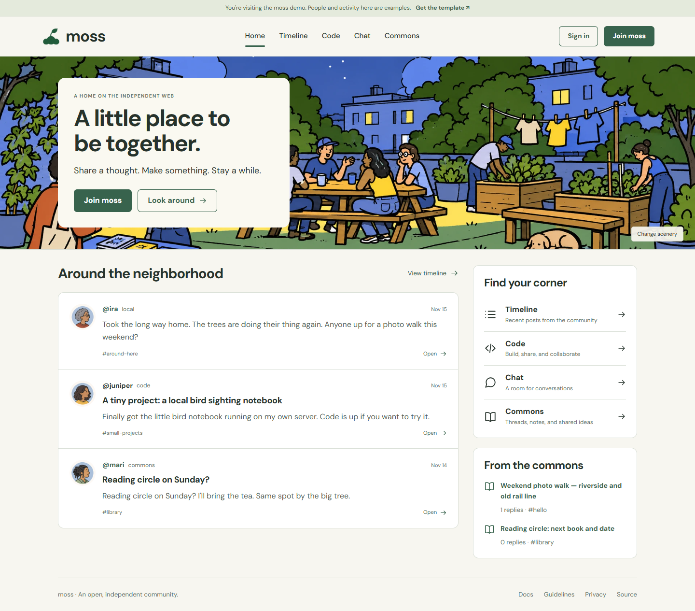
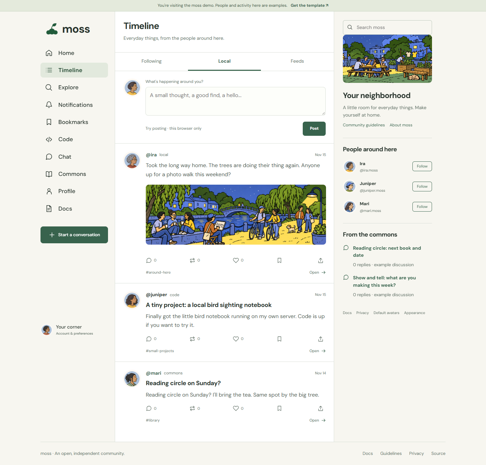
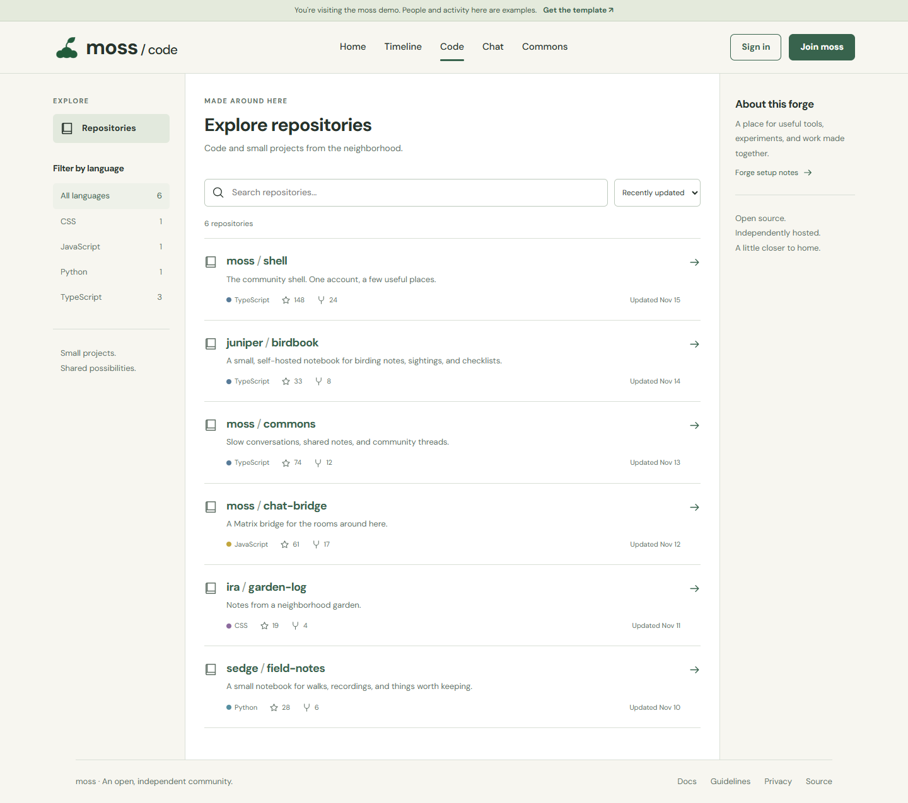
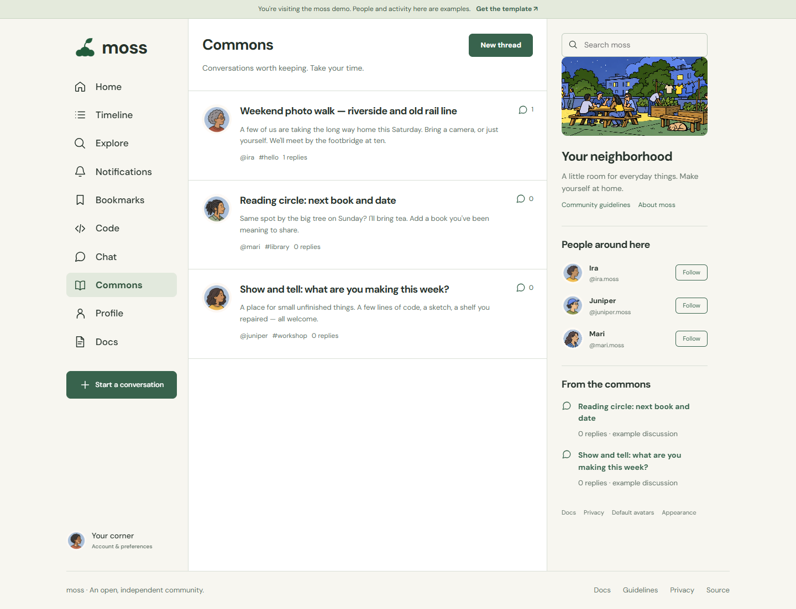
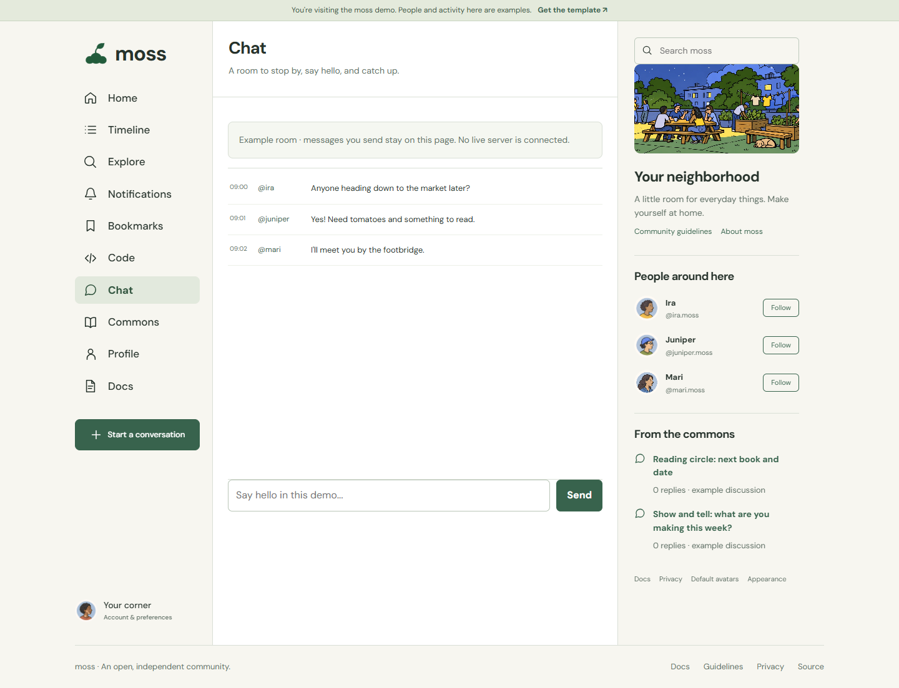
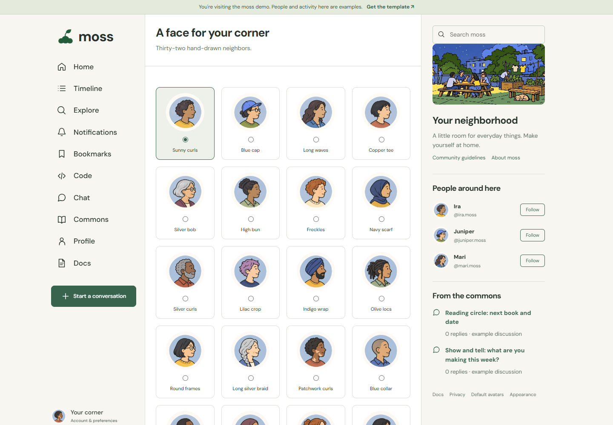
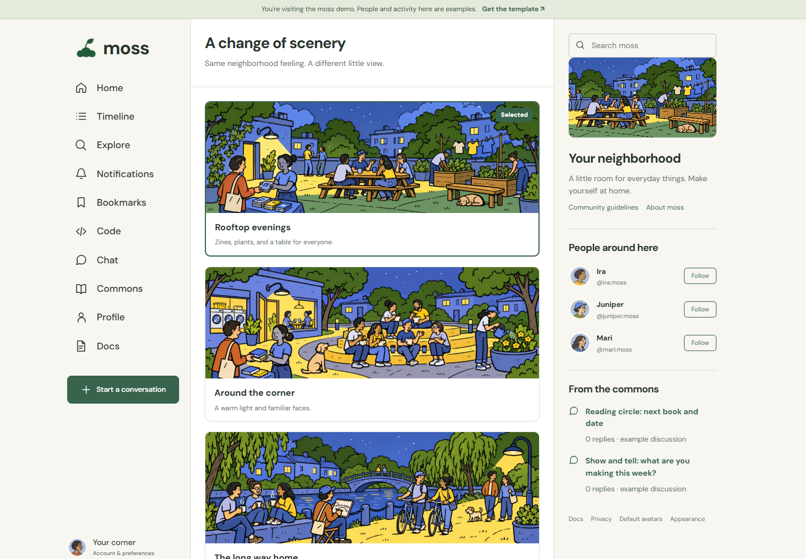
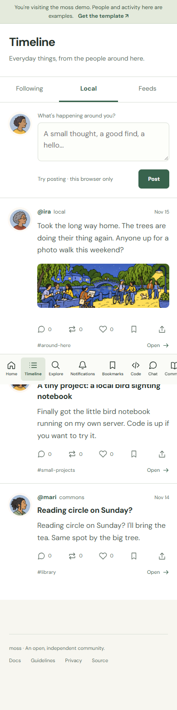

# moss

A little place to be together. A self-hosted community with a timeline, a code hub, a chat room, and conversations worth keeping.

[Try the public demo](https://noahisarider.github.io/moss/) · [Design notes](DESIGN.md) · [ISC license](LICENSE)



## A look around

Screenshots from the current [public showcase](https://noahisarider.github.io/moss/). Example people and activity belong to the isolated demo; a fresh production instance starts empty.

<table>
<tr>
<td width="50%" valign="top"><a href="https://noahisarider.github.io/moss/timeline/"></a><br><strong>Timeline</strong> — A familiar social layout with room for everyday things.</td>
<td width="50%" valign="top"><a href="https://noahisarider.github.io/moss/code/"></a><br><strong>Code</strong> — Repositories first, with search, filtering, and sorting.</td>
</tr>
<tr>
<td width="50%" valign="top"><a href="https://noahisarider.github.io/moss/community/"></a><br><strong>Commons</strong> — Slower conversations and replies that stay together.</td>
<td width="50%" valign="top"><a href="https://noahisarider.github.io/moss/chat/"></a><br><strong>Chat</strong> — A room to stop by and say hello.</td>
</tr>
<tr>
<td width="50%" valign="top"><a href="https://noahisarider.github.io/moss/avatars/"></a><br><strong>Default avatars</strong> — 32 hand-drawn portraits.</td>
<td width="50%" valign="top"><a href="https://noahisarider.github.io/moss/appearance/"></a><br><strong>Change scenery</strong> — Four original scenes, saved per browser.</td>
</tr>
</table>

<p><a href="docs/screenshots/mobile-neighborhood.png"></a></p>

The same community fits a smaller screen. [Explore the live demo](https://noahisarider.github.io/moss/).

## Getting started

Requires Node.js 22 or newer.

```sh
git clone https://github.com/NoahIsARider/moss.git
cd moss
npm ci
cp .env.example .env
node -e "console.log(require('crypto').randomBytes(32).toString('hex'))"
# Put that random value in MOSS_SECRET; set your domain and base URL.
npm run dev
```

For deployment, run `npm run build` then `npm start`. Keep the `.data/` directory on a persistent volume and back it up. This starter uses a JSON store with serialized writes within one application process; run one web writer. It is intended for small communities, not multiple worker replicas. The optional standalone chat bridge is for trusted local deployments; it shares the file, uses separate write coordination, and does not authenticate its WebSocket handles. Use the authenticated web chat for public writing. A database-backed store and coordinated bridge writes are needed before scaling to multiple writers.

A new instance starts with **no users, posts, discussions, messages or repositories**. The application never imports sample fixtures, even if a legacy MOSS_DEMO variable remains in the environment. Existing records are preserved. The old opt-in seeding mode has been removed.

## Places

| Place | What works |
| --- | --- |
| Home | Original illustrated scenery, real recent activity and service links |
| Timeline | Authenticated image/text posts, following/local feeds, RSS/Atom aggregation |
| Code | Real Forgejo repositories with search, language filters and sorting |
| Commons | Accounts, discussion threads, channels and replies |
| Chat | Authenticated local messages and live SSE updates; optional Matrix reading |
| Account | Signed sessions, your threads and replies, persistent default avatar selection and image uploads |
| Appearance | Four original backgrounds, saved per browser |
| Avatars | Thirty-two generated hand-drawn portraits; stable fallback by handle |

Buttons are attached to actual supported behavior. Following, likes, reposts, bookmarks, post replies and notifications are backed by real account data. There are no invented engagement counts or fake people in the production template.

## Real data

Set FORGEJO_BASE_URL and FORGEJO_TOKEN to read repository data. FORGEJO_OWNER optionally restricts results to an owner. Failed or empty responses remain empty; they never substitute demo repositories. MOSS_FEEDS accepts comma-separated RSS or Atom URLs. Local posts and commons threads also appear in `/feed.xml`.

Accounts, short posts, threads, replies and chat use `.data/moss.json`. MOSS_DATA_DIR can select another persistent directory. Database corruption raises an error rather than silently replacing records. Default avatar choices are stored on the real user record. Never commit `.env`, `.data` or credentials.

Matrix credentials enable reading a room alongside local web chat. WebFinger, NodeInfo and RSS are discovery surfaces; this template does not claim ActivityPub compatibility.

## Appearance

The visual system follows the approved home, Code and social design proposals: warm ivory, forest green, readable self-hosted DM Sans, fine dividers and generous layouts. Four original cartoon backgrounds use thick ink contours and flat blue/green/yellow colors, with content distinct from the reference artwork.

Visit `/appearance` to choose Rooftop evenings, Around the corner, The long way home or One more stop. Set NEXT_PUBLIC_MOSS_BACKGROUND to `rooftop`, `plaza`, `riverside` or `nightmarket` before building for the instance default. Visitor choices stay in browser storage. Visit `/avatars` while signed in to save one of thirty-two portraits. Fonts and final images are all served locally.

## GitHub Pages showcase

`demo/` is an independent static Next.js app. It reuses presentation components, but has its own explicit example content and no imports from the production store, auth or integration config. The demo build never copies `.env`, `.data` or uploads. Example people, repositories and counts are clearly labeled. Posting/chat previews and preferences are browser-only; the public site does not pretend to provide a backend.

```sh
npm run build:demo
node scripts/serve-demo.mjs
# http://127.0.0.1:3300/moss/
```

The output is `demo/out/`. PAGES_BASE_PATH defaults to `/moss`; set it to your repository path (or an empty string for a root-domain site). The workflow in `.github/workflows/pages.yml` deploys the showcase on pushes to main. Enable GitHub Pages with the GitHub Actions source in repository settings. It does not deploy the server application.

## Validation

```sh
npm test
npm run typecheck
npm run build
npm run build:demo
```

Store tests cover empty-start isolation, serialized updates, preservation of existing records and corrupt-data handling. Browser checks cover real signup/sign-in, posts, discussions/replies, chat, avatar persistence, scenery, repository controls and mobile overflow. Browser test records belong in an isolated MOSS_DATA_DIR, never the public demo.

The application and deployment files are ISC licensed. DM Sans is self-hosted; retain font license notices when redistributing. Generated illustrations and portrait assets ship with the template and can be replaced.
