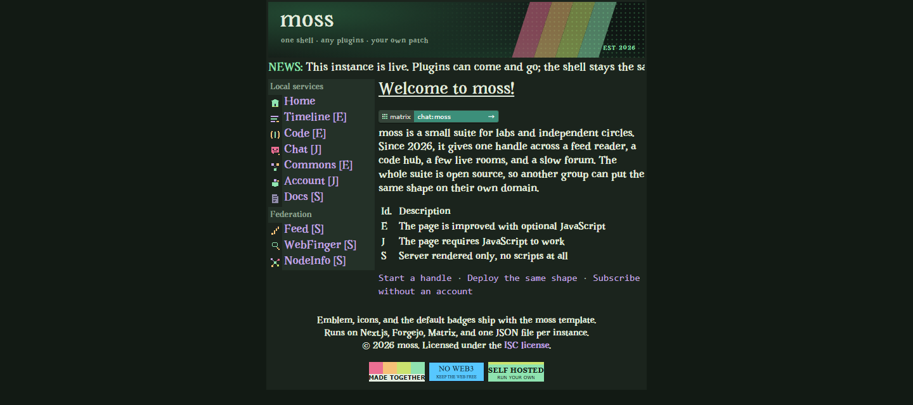
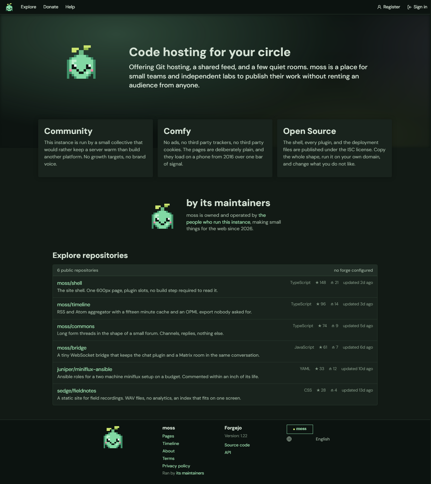
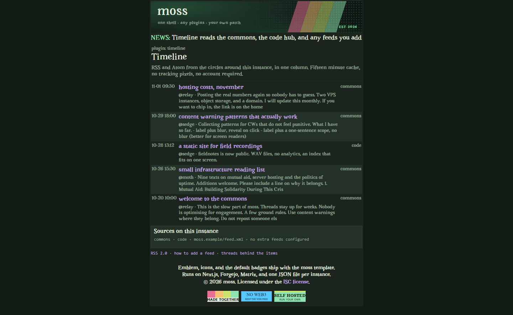
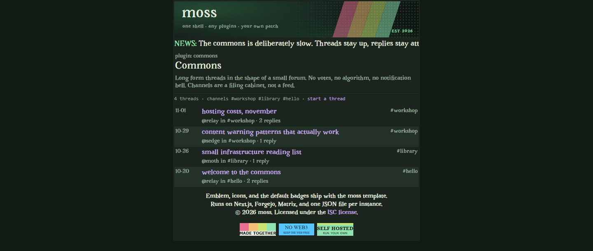
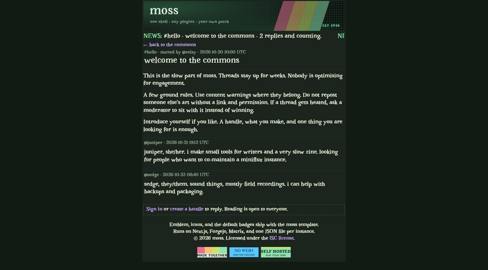
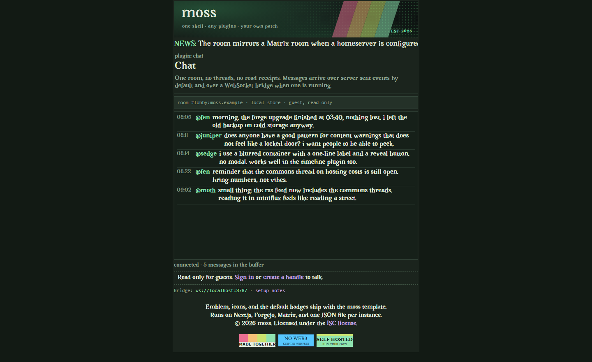
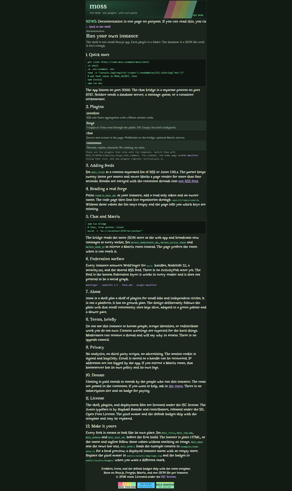

# moss

A template for a small, self-hostable community site. One shell, a shelf of plugins, one account, your own domain.

moss is meant to be forked or downloaded, renamed, and put on a server for a lab, a reading group, a makerspace, or any small circle that wants a place of its own. It deliberately follows the plain web shapes of older community sites: a centred 600px table for the shell, a Forgejo-flavoured page for the code hub, square edges, self-hosted type, no trackers.

## Screens

<table>
<tr>
<td align="center" width="50%"><br><sub>The shell. One 600px table, a service list, a news bar.</sub></td>
<td align="center" width="50%"><br><sub>The code hub. Forgejo's shape, your repositories.</sub></td>
</tr>
<tr>
<td align="center"><br><sub>The timeline. RSS and Atom in one column, fifteen minute cache.</sub></td>
<td align="center"><br><sub>The commons. Threads, channels, no ranking.</sub></td>
</tr>
<tr>
<td align="center"><br><sub>A thread, replies attached in order.</sub></td>
<td align="center"><br><sub>The chat room. Server sent events by default, WebSocket when the bridge runs.</sub></td>
</tr>
<tr>
<td align="center" colspan="2"><br><sub>The docs page ships with the template and explains every environment key.</sub></td>
</tr>
</table>

Screens were taken at 1440px with `MOSS_DEMO=1`, so the example threads, rooms, and repositories are visible. A new instance starts empty.

## Use this template

1. Fork the repository, or download the archive and push it to a remote you control.
2. Copy `.env.example` to `.env` and fill in the identity keys.
3. Run `npm install`, then `npm run build` and `npm start`.
4. Point your reverse proxy at the app and the chat bridge.

The name, tagline, domain, and footer year are read from the environment. The banner is plain HTML, so no image needs to be edited when you rename the site. Replace `public/assets/img/logo.svg` and the files in `public/assets/badges/` if you want a different mark.

## What is in the box

| Plugin | Route | What it does |
| --- | --- | --- |
| Shell | `/` | One 600px frame, service list, news bar, account entry points |
| Timeline | `/timeline`, `/feed.xml` | RSS and Atom aggregation with a 15 minute cache |
| Forge | `/code` | Forgejo or Gitea repository list through the public API |
| Chat | `/chat`, `/api/chat/stream`, port 8787 | Server sent events in the page, WebSocket bridge, optional Matrix mirror |
| Commons | `/community` | Threads, replies, channels, no ranking |

Every plugin can be switched off with `MOSS_PLUGINS`. The shell, account system, and feed stay in place. To add a plugin, add its route and its entry in `lib/plugins.ts`; the sidebar and the plugin manifest pick it up.

Federation surface: `/.well-known/webfinger`, `/.well-known/nodeinfo`, `/nodeinfo/2.1`, `/.well-known/security.txt`, `/feed.xml`.

## Run it

```bash
npm install
cp .env.example .env
node -e "console.log(require('crypto').randomBytes(32).toString('hex'))"   # MOSS_SECRET
npm run dev
```

The web app is on `http://localhost:3000`. The chat bridge is a second process.

```bash
npm run bridge
```

Without a Forgejo token the code page shows an empty repository list with a note on what to set. Without Matrix credentials the chat page reads the local JSON store. A new instance starts with no threads and no messages; `MOSS_DEMO=1` loads the example content in `examples/demo-data.ts` for local previews.

For a production box:

```bash
npm run build
npm start
```

Or `docker compose up --build`, which runs both services against one `moss-data` volume.

## Environment

| Key | Purpose |
| --- | --- |
| `MOSS_TITLE` | Site name used in the banner, page titles, and footer |
| `MOSS_TAGLINE` | Line under the banner name |
| `MOSS_DESCRIPTION` | Meta description and NodeInfo summary |
| `MOSS_DOMAIN` | Hostname used in federation documents |
| `MOSS_BASE_URL` | Absolute base, including scheme |
| `MOSS_ESTABLISHED` | Year shown in the banner and the about page |
| `MOSS_DEMO` | Set to `1` to load example threads, chat and repositories. Leave unset on a real instance |
| `MOSS_NEWS` | Text in the scrolling news bar under the banner |
| `MOSS_PLUGINS` | Comma separated plugin ids, order used by the sidebar |
| `MOSS_SECRET` | HMAC key for session cookies, change this |
| `MOSS_FEEDS` | Extra RSS or Atom URLs for the timeline |
| `MOSS_CODE_URL` | Public URL of your Forgejo instance, used for repository links |
| `MOSS_REPOSITORY_URL` | Public clone URL of this template, used in docs and NodeInfo |
| `MOSS_SECURITY_EMAIL` | Contact address in `security.txt` |
| `FORGEJO_BASE_URL`, `FORGEJO_TOKEN`, `FORGEJO_OWNER` | Live repository list |
| `MATRIX_HOMESERVER_URL`, `MATRIX_ACCESS_TOKEN`, `MATRIX_ROOM_ID` | Mirror a Matrix room |
| `CHAT_BRIDGE_PORT` | WebSocket port, default 8787 |

## Structure

```
app/            pages, server actions, API and federation routes
components/     shell frame, page parts, chat client
lib/            config, store, auth, feeds, forge, matrix, markdown
server/         WebSocket chat bridge
public/assets   fonts, icons, badges, pixel mark
examples/       opt-in demo content, loaded only when MOSS_DEMO=1
```

The account system is local: scrypt password hashing, an HMAC-signed httpOnly cookie, one handle across every plugin. The data store is `.data/moss.json`, written atomically, and it is created empty. Replace it with a real database when a second instance needs to share state.

## Customising

Set the environment first. The palette lives in `app/globals.css` under `:root`; the shell structure lives in `components/shell/Frame.tsx`. The page copy is in `app/` and the example content is in `examples/demo-data.ts`. Delete `.data/moss.json` to return to an empty store.

## Design

Read [DESIGN.md](DESIGN.md) before changing anything visual. It is a fidelity contract, not a mood board. The short version is that the layout follows two existing plain-web references and only the brand, palette details, and copy belong to each instance.

## License

ISC. The Avara typeface is by Raphaël Bastide and contributors under the SIL Open Font License. DM Sans is under the SIL Open Font License.
